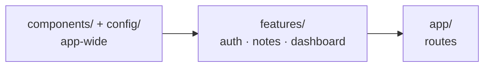

# Next.js starter

A simple, scalable starter for production-ready Next.js apps with TypeScript, tests, CI and a feature-based structure.

- Video: <video link>
- Step-by-step guide: <Medium guide link>
- Naming conventions cheat sheet: <cheat sheet link>

## Table of contents

- [Getting started](#getting-started)
- [What's included](#whats-included)
- [Scripts](#scripts)
- [Project structure](#project-structure)
- [Environment variables](#environment-variables)
  - [Add or change a variable](#add-or-change-a-variable)
- [Contribution guide](#contribution-guide)
- [Deployment](#deployment)
- [Make it yours](#make-it-yours)
- [License](#license)

## Getting started

**Requirements:** Node.js 22.12+, 24 or 26+ (see `.nvmrc`) and pnpm (see `packageManager` in `package.json`).

1. **Create your project** (one command, fresh Git history):

   ```bash
   pnpm create next-app@latest my-app --example https://github.com/<your-account>/<repo-name>
   ```

   Or click **Use this template** on GitHub, clone your new repo, and run `pnpm install`.

2. **Create your local env file** (it's never committed), then change the values to yours:

   ```bash
   cp .env.example .env
   ```

   Need other variables? See [Add or change a variable](#add-or-change-a-variable).

3. **Start the dev server** at `http://localhost:3000`:

   ```bash
   pnpm dev
   ```

## What's included

| Tool                                | Used for                                             |
| ----------------------------------- | ---------------------------------------------------- |
| Next.js (App Router), TypeScript    | Framework and language (strict mode)                 |
| Tailwind CSS, shadcn/ui             | Styling and UI components                            |
| ESLint, Prettier                    | Clean code, one format, sorted Tailwind classes      |
| Husky, lint-staged, commitlint      | Checks on every commit, Conventional Commit messages |
| Vitest, Testing Library, Playwright | Unit tests, end-to-end tests, accessibility checks   |
| GitHub Actions                      | CI on every push and pull request                    |
| React Hook Form, Zod                | Forms and validation                                 |
| TanStack Query, Zustand             | Server state (API data) and client state             |
| next-themes                         | Dark mode (light, dark or system)                    |
| Next.js metadata                    | SEO: titles, sitemap, robots, social image           |
| Docker                              | Self-hosting (not needed on Vercel)                  |

## Scripts

| Command                                 | What it does                       |
| --------------------------------------- | ---------------------------------- |
| `pnpm dev`                              | Start the dev server               |
| `pnpm build`                            | Build for production               |
| `pnpm start`                            | Run the production build           |
| `pnpm lint` / `pnpm lint:fix`           | Check / fix lint errors            |
| `pnpm format:check` / `pnpm format:fix` | Check / fix formatting             |
| `pnpm typecheck`                        | Check types                        |
| `pnpm test` / `pnpm test:watch`         | Unit tests (once / watch mode)     |
| `pnpm test:e2e`                         | End-to-end tests in a real browser |
| `pnpm remove-example`                   | Delete the example app (run once)  |

## Project structure

```
src/
├── app/                  # routes: each page imports one screen from a feature
│   ├── layout.tsx        # site metadata, header, providers
│   ├── providers.tsx     # dark mode + TanStack Query
│   ├── page.tsx          # /
│   ├── notes/page.tsx    # /notes
│   └── login/page.tsx    # /login
├── features/             # one folder per feature: auth, notes, dashboard
│   └── notes/            # every feature has the same shape
│       ├── api/          # loading data (fetch + TanStack Query hook)
│       ├── components/   # building blocks
│       ├── screens/      # one per page, imported by app/
│       ├── schemas/      # Zod schemas and types
│       ├── stores/       # client state (Zustand)
│       └── index.ts      # front door: the only file other code may import
├── components/           # app-wide UI: shadcn components (ui/), site header (layout/)
└── config/               # site config, environment variables
e2e/                      # end-to-end tests
```

Code flows one way: app-wide code is used by features, and features are used by `app/`.



Rules:

- Import another feature only through its front door (`@/features/notes`), never its inner files. ESLint enforces this.
- Files and folders are kebab-case (`login-form.tsx`). Full naming rules in the cheat sheet linked above.
- Unit tests sit next to the file they test (`*.test.ts`); end-to-end tests live in `e2e/` (`*.spec.ts`).

## Environment variables

| Name                   | Example                                  | What it's for                                  |
| ---------------------- | ---------------------------------------- | ---------------------------------------------- |
| `NEXT_PUBLIC_SITE_URL` | `https://example.com`                    | The site's address (SEO, sitemap)              |
| `NEXT_PUBLIC_APP_ENV`  | `development` / `staging` / `production` | Only `production` is indexed by search engines |
| `NEXT_PUBLIC_API_URL`  | `https://jsonplaceholder.typicode.com`   | The API the notes come from                    |

- Every value has a safe default (`src/config/env.ts`), so the app and CI work with no setup.
- Locally: copy `.env.example` to `.env`. CI: set them as GitHub variables (Settings → Secrets and variables → Actions → Variables). On your host, set them in its settings.
- A wrong value fails the build with a clear message. So does a missing `NEXT_PUBLIC_SITE_URL` when `NEXT_PUBLIC_APP_ENV` is `production`.
- `NEXT_PUBLIC_` values reach the browser and are baked in at build time. Never put secrets in them.

### Add or change a variable

Example: adding `NEXT_PUBLIC_ANALYTICS_ID`.

1. **`.env.example` and your `.env`:** add the line.

   ```
   NEXT_PUBLIC_ANALYTICS_ID=your-id
   ```

2. **`src/config/env.ts`:** add a short name to the schema (with `.optional()` or a `.default(…)` if the app can run without it), and map it to the full `process.env.NEXT_PUBLIC_…` name below. Write that full name out: Next.js only puts it in the browser code when it sees it.

   ```ts
   const envSchema = z.object({
     // ...
     ANALYTICS_ID: z.string().optional()
   });

   const result = envSchema.safeParse({
     // ...
     ANALYTICS_ID: valueOf(process.env.NEXT_PUBLIC_ANALYTICS_ID)
   });
   ```

   Then use it as `env.ANALYTICS_ID`.

3. **Everywhere the app is built:** a line in the `env:` block of `.github/workflows/ci.yml` (`${{ vars.NEXT_PUBLIC_ANALYTICS_ID }}`) plus the variable in GitHub's settings, your host's settings (e.g. Vercel), and for Docker the `args` in `docker-compose.yml` plus an `ARG` and `ENV` line in the `Dockerfile`. A required variable you forget fails the build and names the variable.

To remove a variable, delete it from the same places. Secrets (no `NEXT_PUBLIC_`) don't go in `env.ts`: give them their own file starting with `import 'server-only'`.

## Contribution guide

1. **Start from `dev`:**

   ```bash
   git checkout dev
   git pull
   git checkout -b feat/my-change
   ```

2. **Commit with Conventional Commits** (checked on every commit): `feat`, `fix`, `docs`, `style`, `refactor`, `perf`, `test`, `build`, `ci`, `chore`, `revert`. Example: `feat: add notes search`.

3. **Push and open a pull request into `dev`.** CI must pass before it can be merged.

4. **Release:** open a pull request from `dev` into `main`.

## Deployment

**Vercel:** import the repo and set the three environment variables for each environment. `main` deploys to production, `dev` to staging.

**Docker (self-hosting):** put your real values in `.env`, then:

```bash
docker compose up --build
```

The app runs at `http://localhost:3000`. For another set of values, use `docker compose --env-file .env.production up --build`.

## Make it yours

**Versions**

- [ ] Your Node version in `.nvmrc` and both `FROM node:` lines in the `Dockerfile`
- [ ] Your pnpm version in `packageManager` and the `Dockerfile`
- [ ] `@types/node` matches your Node version

**Rename**

- [ ] `name` in `package.json`
- [ ] The title of this README
- [ ] `name` and `description` in `src/config/site.ts`

**Remove the example**

```bash
pnpm remove-example
```

It deletes the example features, pages and tests, leaves a plain home page and one test of each kind, then deletes itself. You can then delete this section and the `remove-example` row in Scripts.

## License

MIT
